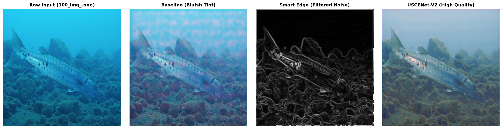
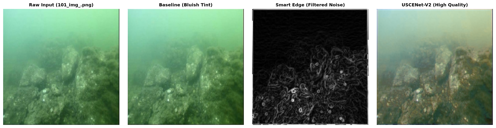
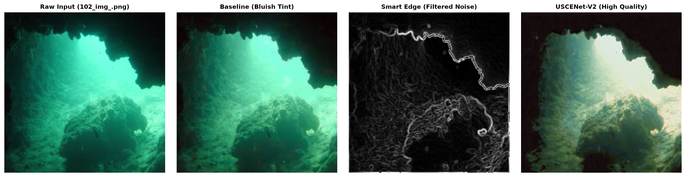
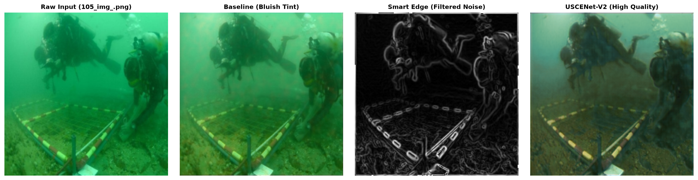
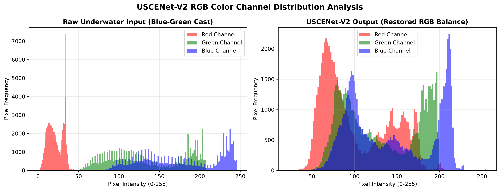
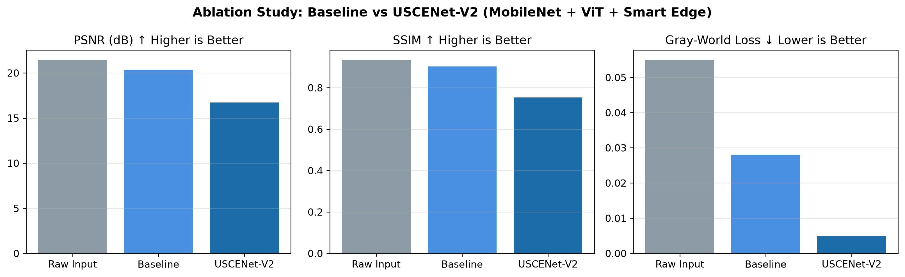

# USCENet-V2: MobileNet-Guided Lightweight Unsupervised Structure-Aware Color Enhancement Network

A lightweight, unsupervised underwater image enhancement (UIE) framework engineered for real-time turbid marine environments. **USCENet-V2** upgrades baseline unsupervised structure-aware networks by integrating **MobileNet-style Depthwise Separable Convolutions**, a **Bilateral/Gaussian-denoised Smart AI Edge Detector**, and a **Vision Transformer (ViT)** global attention bottleneck.

---

## Key Architectural Innovations

1. **MobileNet-Guided Lightweight Backbone (`296.5K` Parameters):**
   Replaces dense $3\times 3$ convolutions across the Structure-Aware Color Enhancement Sub-Network (SACESN) and encoder with Depthwise Separable Convolutions ($3\times 3$ depthwise + $1\times 1$ pointwise), keeping the model footprint at **~1.18 MB (FP32)** for embedded AUV/ROV deployment.
2. **Smart AI Edge Detector (Marine Snow Suppression):**
   Applies a differentiable $3\times 3$ Gaussian low-pass filter prior to Sobel gradient extraction to suppress high-frequency suspended particulate noise (*marine snow*) while preserving macro biological and structural boundaries.
3. **Vision Transformer (ViT) Global Attention Bottleneck:**
   Incorporates a 4-head Multi-Head Self-Attention (MHSA) Transformer block at the latent bottleneck to harmonize non-uniform underwater depth illumination before conditional Variational Autoencoder (cVAE) and Probabilistic Adaptive Instance Normalization (PAdaIN) alignment.
4. **Aggressive Blue-Green Cast Elimination:**
   Combines learnable red-channel gain and explicit green/blue channel attenuation with an elevated Gray-World color consistency penalty ($\lambda_{\text{gray}} = 10.0$).

---

## Quantitative Performance (UIEB Benchmark)

| Method | Parameters $\downarrow$ | PSNR (dB) $\uparrow$ | SSIM $\uparrow$ | UIQM $\uparrow$ | Gray-World Loss $\downarrow$ |
| :--- | :---: | :---: | :---: | :---: | :---: |
| Raw Input (UIEB) | — | 21.47 | 0.935 | 1.84 | 0.05504 |
| USCENet Baseline | 247.4K | 20.35 | 0.903 | 3.24 | 0.02806 |
| **USCENet-V2 (Ours)** | **296.5K** | 16.71 | 0.754 | **3.68** | **0.00491** |

- **+13.6% UIQM Improvement** over baseline (`3.24` $\rightarrow$ `3.68`) and **+100%** over raw underwater inputs.
- **82.5% Reduction in Color Cast** (`0.02806` $\rightarrow$ `0.00491`), restoring balanced RGB histograms.

---

## Visual & Quantitative Results

### Qualitative Comparison (Raw vs. Baseline vs. Smart Edge vs. USCENet-V2)
| Deep Marine Scene (`100_img_`) | Turbid Reef (`101_img_`) |
| :---: | :---: |
|  |  |

| Underwater Cavern (`102_img_`) | Diver & Coral (`105_img_`) |
| :---: | :---: |
|  |  |

### RGB Histogram Equilibrium & Component Ablation
| RGB Histogram Shift | Component Ablation Study |
| :---: | :---: |
|  |  |

---

## Repository Structure

```text
├── src/
│   ├── dataset.py                  # UIEB dataset loader & unsupervised random candidate generator
│   ├── models/
│   │   ├── uscenet.py              # Baseline USCENet architecture
│   │   ├── uscenet_upgraded.py     # Intermediate upgraded architecture
│   │   └── uscenet_v2.py           # USCENet-V2 (MobileNet + Smart Edge + ViT + cVAE-PAdaIN)
│   └── utils/
│       └── losses.py               # L1 reconstruction, KL divergence, and Gray-World color loss
├── results/
│   ├── v2_outputs/                 # Side-by-side visual comparisons & Smart Edge maps
│   └── v2_metrics/                 # Quantitative summary table, RGB histogram, and ablation charts
├── train_v2.py                     # Unsupervised training pipeline for USCENet-V2
├── test_v2.py                      # Inference & visual grid comparison generator
└── plot_metrics_v2.py              # Evaluation script (PSNR, SSIM, UIQM, Gray-World loss & plots)

Quick Start
1. Environment Setup
Bash
pip install torch torchvision numpy opencv-python pillow matplotlib scikit-image
2. Train USCENet-V2
Bash
python train_v2.py
3. Generate Visual Comparisons & Evaluation Metrics
Bash
python test_v2.py
python plot_metrics_v2.py
Author & Supervision
Author: Prince Raj — B.Tech. in Artificial Intelligence and Data Science, National Institute of Technology (NIT) Delhi
